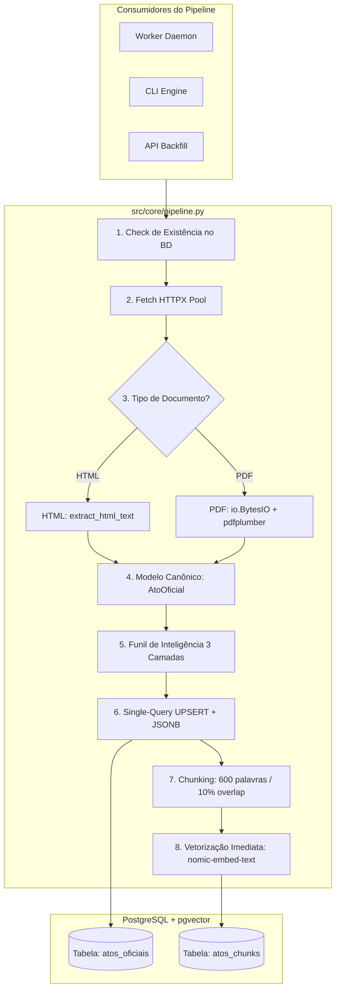
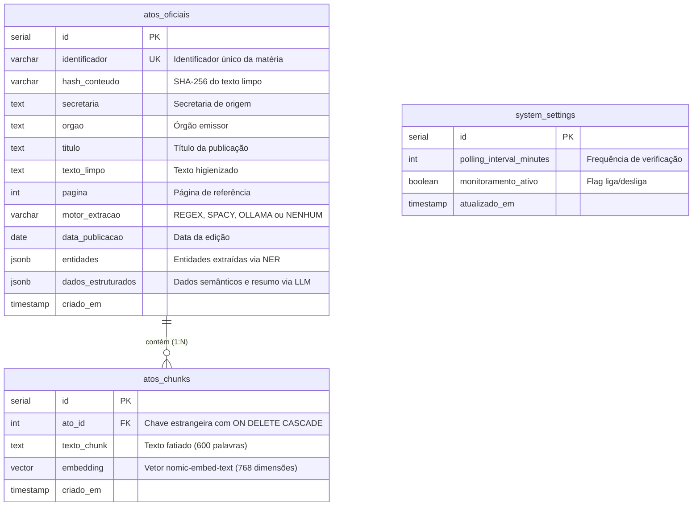
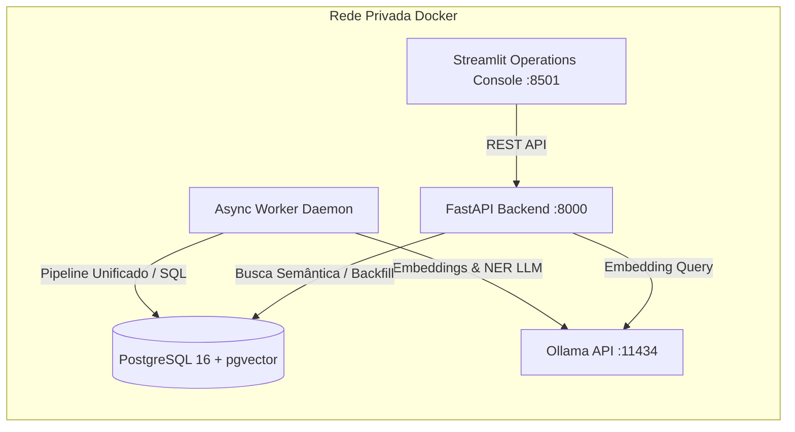

# Manifesto Técnico: Arquitetura RAG Local DOE-BA

Este documento detalha as decisões arquiteturais, o fluxo de dados e os contratos de engenharia do **DOE-BA Intelligence Engine**.

> [!NOTE]
> Para uma explicação didática detalhada de cada componente voltada para aprendizado, consulte o **[Livro Mestre da Plataforma](docs/README.md)**.

---

## 1. O Fluxo RAG (Retrieval-Augmented Generation)

O sistema opera um pipeline de dados assíncrono, linear e unificado, projetado para transformar publicações oficiais brutas em conhecimento semântico indexado sem latência de polling.

### A. Ingestão e Captura (Core Engine)
- **Descoberta:** O sistema consulta as APIs e rotas estruturadas do Diário Oficial da Bahia para identificar novas edições por data ou intervalo.
- **Resiliência Legada:** O servidor alvo utiliza a versão legada Apache/2.2.22. Para evitar sobrecargas, bloqueios e contenção:
    - **Pool de Conexões Persistente:** Uso do `httpx.AsyncClient` com reaproveitamento de sockets TCP e HTTP Keep-Alive, eliminando o overhead de handshakes repetidos.
    - **`asyncio.Semaphore(8)`:** Concorrência controlada com teto de 8 requisições simultâneas.
    - **Jitter Aleatório:** Atraso dinâmico de 200ms a 500ms entre chamadas.
    - **Exponential Backoff:** Retentativas automáticas em caso de instabilidades transitórias de rede (2s, 4s, 8s).
- **Extração 100% em Memória (Zero Disk I/O):**
    - **HTML:** Extração de sumários e textos diretamente dos fragmentos via `BeautifulSoup` / `lxml`.
    - **PDF:** Processamento direto em streams binárias com **`io.BytesIO`** e **`pdfplumber`** 100% em memória RAM, sem gravação em disco rígido, garantindo segurança de concorrência, ausência de descritores de arquivos órfãos e máxima velocidade de I/O.

### B. O Pipeline Unificado (`src/core/pipeline.py`)
O processamento de matérias foi unificado em uma função canônica linear: `process_ato_pipeline`:
1. **Prevenção de Duplicidade:** Checa previamente a existência do identificador no PostgreSQL antes de realizar o download.
2. **Download e Extração:** Baixa o payload bruto (como `DownloadedDocument`) e extrai o texto em memória.
3. **Contrato Canônico:** Instanciação do modelo `AtoOficial` (`src/core/models.py`), o Single Source of Truth tipado.
4. **Sanitização:** Normalização através do `clean_text`, removendo ruídos governamentais e gerando o hash SHA-256.
5. **Funil de Inteligência:** Classificação e extração de entidades em 3 camadas (Regex $\to$ Spacy NER $\to$ Ollama Fallback).
6. **Persistência Atômica:** Single-Query UPSERT no PostgreSQL com armazenamento de metadados em colunas nativas **JSONB**.
7. **Chunking e Vetorização Imediata:** Geração imediata de blocos textuais e embeddings (`nomic-embed-text`), gravando na tabela `atos_chunks` no mesmo ciclo. **Eliminou-se qualquer atraso de polling para vetorização.**

### C. Consumidores Leves
Todos os pontos de entrada do sistema são clientes diretos do pipeline unificado:
- **`src/worker.py`:** Loop de monitoramento que checa a edição do dia e a processa via `process_edition_pipeline`. Possui apenas um sweeper de segurança (`drain_pending_vectors`) para reprocessar chunks que eventualmente falharam por indisponibilidade transitória do Ollama.
- **`src/cli.py`:** Execução pontual sob demanda para processamento por ID, data ou intervalo histórico.
- **`src/api/routes.py`:** Endpoint `/ingest/backfill` que roda o mesmo pipeline em segundo plano.

---

### D. Diagrama do Pipeline de Execução



---

## 2. O Funil de Inteligência (Intelligence Layer)

Para equilibrar custo computacional, velocidade e profundidade semântica, o processamento adota um funil de três camadas em cascata (`src/intelligence/engine.py`):

1. **Camada 1 (Lexical/Regex):** Avaliação relâmpago contra as palavras-chave e pessoas monitoradas da `watchlist.yaml`. Se não houver match, o ato é classificado rapidamente sem sobrecarregar modelos estatísticos ou neurais.
2. **Camada 2 (NLP Estatístico - Spacy):** Execução do modelo `pt_core_news_sm` para Reconhecimento de Entidades Nomeadas (Pessoas, Organizações, Valores). O resultado é validado no modelo `EntidadesExtraidas`.
3. **Camada 3 (Semântica/LLM Local - Ollama):** Acionamento sob demanda do modelo `qwen2.5:1.5b` via formato JSON nativo para síntese executiva e estruturação contratual profunda quando a extração estatística exige complementação.

> [!TIP]
> **Persistência Consolidada em JSONB:** Toda a saída de inteligência (Spacy e Ollama) é encapsulada no modelo canônico `AtoOficial` e persistida diretamente nas colunas `entidades` e `dados_estruturados` em **JSONB nativo** do PostgreSQL, garantindo integridade transacional atômica e capacidade de consultas relacionais avançadas com indexação GIN.

---

## 3. Modelo de Dados Relacional e Vetorial (PostgreSQL + pgvector)

O banco de dados é inicializado e mantido de forma idempotente em `PostgresRepository.setup_schema()`.



### Single-Query UPSERT Atômico
A inserção do ato oficial é executada em instrução SQL única e concorrente:
```sql
INSERT INTO atos_oficiais (
    identificador, hash_conteudo, secretaria, orgao,
    titulo, texto_limpo, pagina, motor_extracao,
    data_publicacao, entidades, dados_estruturados
) VALUES (
    $1, $2, $3, $4, $5, $6, $7, $8, $9, $10::jsonb, $11::jsonb
)
ON CONFLICT (identificador) DO UPDATE SET
    hash_conteudo = EXCLUDED.hash_conteudo,
    secretaria = EXCLUDED.secretaria,
    orgao = EXCLUDED.orgao,
    titulo = EXCLUDED.titulo,
    texto_limpo = EXCLUDED.texto_limpo,
    pagina = EXCLUDED.pagina,
    motor_extracao = EXCLUDED.motor_extracao,
    entidades = COALESCE(EXCLUDED.entidades, atos_oficiais.entidades),
    dados_estruturados = COALESCE(EXCLUDED.dados_estruturados, atos_oficiais.dados_estruturados)
RETURNING id;
```
Essa abordagem garante:
- **Zero Race Conditions:** Múltiplos workers ou chamadas de backfill não causam duplicação de dados.
- **Recuperação Imediata do ID:** O `RETURNING id` fornece a chave primária instantaneamente para o fatiamento e inserção dos chunks na sequência do pipeline.

### Busca Semântica por Cosseno
A recuperação semântica RAG é calculada nativamente no motor SQL pelo operador `<=>` (Cosine Distance):
```sql
SELECT c.id, c.texto_chunk, 1 - (c.embedding <=> $1::vector) AS similarity,
       a.identificador, a.titulo, a.secretaria, a.orgao, a.data_publicacao
FROM atos_chunks c
JOIN atos_oficiais a ON c.ato_id = a.id
WHERE c.embedding IS NOT NULL
ORDER BY c.embedding <=> $1::vector
LIMIT $2;
```

---

## 4. Filosofia Local-First & Privacidade

O projeto foi construído sob o princípio da **Soberania Absoluta de Dados**:
- **LGPD:** Diários oficiais contêm nomes civis, CPFs, matrículas e atos de servidores. Nenhum desses dados trafega para APIs públicas ou serviços de terceiros na nuvem.
- **Custo Operacional Zero:** Inferência neural e geração de vetores são executadas localmente via Ollama em hardware commodity.
- **Resiliência Autônoma:** O sistema opera independentemente de chaves de API externas, limites de cota ou instabilidades de rede externa.

---

## 5. Infraestrutura Conteinerizada (Docker Network)

O ecossistema é orquestrado via `docker-compose.yml` em uma rede interna isolada:



---
*Este manifesto define o estado da arte e a verdade arquitetural definitiva da Plataforma DOE-BA.*
