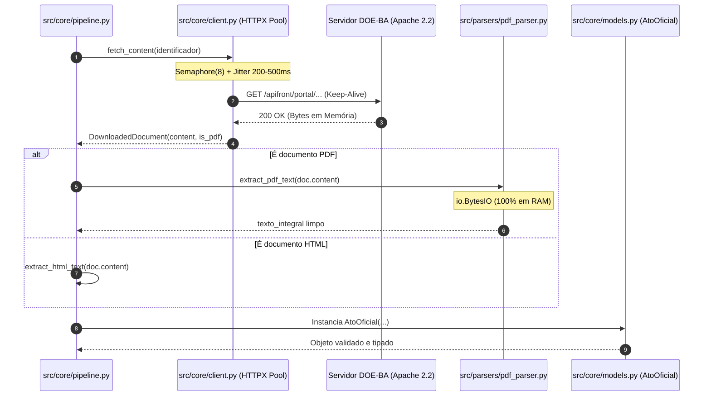

# Capítulo 01: Fundamentos de Web Scraping
> "Antes de correr, precisamos aprender a caminhar silenciosamente pelos corredores digitais."

## 🎓 O que você vai aprender?
* Como o protocolo HTTP funciona na prática de engenharia de dados.
* A diferença vital entre requisições síncronas e assíncronas com Connection Pooling.
* Como respeitar servidores legados (Apache 2.2.22) sem sofrer bloqueios.
* A eliminação do I/O em disco: processando fluxos binários diretamente na memória RAM.

---

## 1. O Beabá: Protocolo HTTP e Verbos

Imagine que o servidor do Diário Oficial é um **bibliotecário** muito ocupado e um tanto rigoroso. Para falar com ele, você usa o protocolo HTTP.

- **GET (A Leitura):** É quando você pergunta: "Você tem a edição do dia 09/05?". Você apenas lê os dados sem alterar o estado do servidor.
- **POST (O Envio):** É quando você envia parâmetros ou formulários para o servidor processar.
- **Status Codes (As Respostas):**
    - **200 OK:** "Aqui está o que você pediu." (Sucesso!)
    - **404 Not Found:** "Essa edição ou matéria não existe." (Caminho inválido)
    - **500 / 503 Internal Server Error:** "O servidor ficou sobrecarregado." (Falta de recursos ou concorrência excessiva)

---

## 2. Síncrono vs Assíncrono: A Analogia da Cafeteria

No modelo **Síncrono clássico (Requests)**, você pede um café no balcão e fica travado esperando a xícara encher. Você não consegue fazer mais nada enquanto a resposta não chega.

No modelo **Assíncrono (`httpx` + `asyncio`)**, você faz o pedido, recebe um sinalizador eletrônico e vai ler um documento. Quando o servidor responde, você é notificado e retoma o processamento. No DOE-BA Engine, usamos `asyncio` e **reaproveitamento persistente de conexões HTTP (Connection Pooling)** para consultar dezenas de matérias simultaneamente, mantendo sockets abertos e sem desperdiçar tempo em handshakes repetidos.

---

## 🔍 Mergulho no Código: Onde a Mágica Acontece

Nesta plataforma, a teoria se traduz em arquivos concretos:

### A. Resiliência e Polidez Digital
No arquivo `src/core/client.py`, implementamos um guardião de concorrência:
```python
self.semaphore = asyncio.Semaphore(8)
```
Isso garante que nosso cliente nunca execute mais do que 8 requisições ao mesmo tempo, blindando o servidor legado **Apache/2.2.22** da EGBA contra exaustão de conexões. Somado a isso, aplicamos um **jitter aleatório de 200 a 500ms** entre chamadas para humanizar o padrão de tráfego.

### B. O Acesso Direto aos Endpoints Estruturados
Em vez de usar navegadores pesados para simular cliques humanos em modais visuais, o `DOEBahiaClient` comunica-se diretamente com os endpoints de dados e fragmentos HTML/JSON da EGBA (`/apifront/portal/...` e `/html/...`). Essa decisão arquitetural reduz o consumo de memória em 90% e acelera a extração em mais de 10 vezes.

### C. Fim do I/O em Disco: Processamento em Memória (`io.BytesIO`)
Quando baixamos um ato em formato PDF, todo o processamento ocorre diretamente na memória RAM sem gravação de arquivos intermediários no disco rígido. No arquivo `src/parsers/pdf_parser.py`, o binário trafega utilizando `io.BytesIO(pdf_bytes)`:
```python
with pdfplumber.open(io.BytesIO(pdf_bytes)) as pdf:
    for page in pdf.pages:
        ...
```
Isso zera a lentidão de escrita em disco, evita vazamentos de descritores de arquivo e elimina qualquer necessidade de pastas temporárias.

### D. Integridade do Dado (Pydantic Single Source of Truth)
Antes de qualquer processamento subsequente, o dado bruto é encapsulado em `DownloadedDocument` e estruturado no modelo canônico `AtoOficial` em `src/core/models.py`. Se o dado estiver incompleto ou violar o contrato, ele é barrado imediatamente.

---

## 3. Fluxo de Sequência da Captura



---

## 4. Para Aprofundar

> [!IMPORTANT]
> **Material de Estudo:** 
> - **Pesquise por:** "Asyncio Semaphores e HTTP Connection Pooling em Python".
> - **Estude o conceito:** "In-memory binary streams com `io.BytesIO` vs arquivos temporários em disco".

---
[Voltar para o Índice](README.md) | [Próximo Capítulo: IA Local](02-inteligencia-artificial-local.md)
