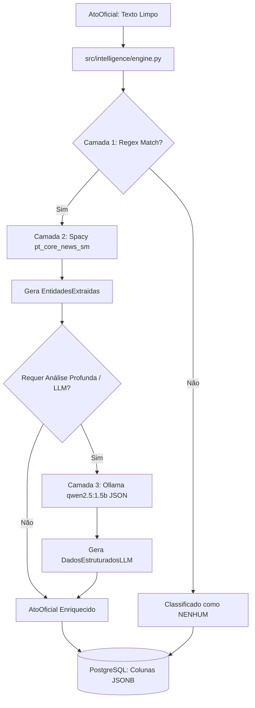

# Capítulo 02: Inteligência Artificial Local
> "Por que pedir permissão à nuvem, se você pode ser o mestre do seu próprio cérebro digital?"

## 🎓 O que você vai aprender?
* A diferença entre IA Generativa (LLMs) e NLP Estatístico (NER).
* A estratégia do "Funil de Inteligência" para economia de hardware local.
* Como o Spacy e o Ollama alimentam colunas nativas **JSONB** no PostgreSQL.
* Por que eliminamos arquivos intermediários de auditoria em prol da integridade do banco.

---

## 1. O Duelo: LLM vs NER

No laboratório do DOE-BA, combinamos dois cérebros complementares:

- **NLP Estatístico (Spacy / NER):** Um classificador de alta velocidade. Não "pensa", mas identifica padrões sintáticos em milissegundos para rotular Pessoas, Organizações e Valores Monetários.
- **IA Generativa (LLM / Ollama):** Um especialista semântico. Entende a nuance do texto legal, resume deliberações complexas e entrega dados estruturados em JSON.

---

## 🔍 Mergulho no Código: O Funil em Ação

Toda a lógica de classificação reside em `src/intelligence/engine.py`. O fluxo segue um funil rigoroso em cascata para poupar ciclos de CPU/GPU:

### Camada 1: O Filtro de Areia (Regex)
O método `match_watchlist` utiliza expressões regulares compiladas para inspecionar termos da sua `watchlist.yaml`. Se um ato não contém palavras de interesse e nem cita pessoas monitoradas, ele é classificado rapidamente como `NENHUM` e não consome recursos de NLP ou redes neurais.

### Camada 2: O Filtro de Água (Spacy NER)
Quando o texto desperta interesse, o método `extract_entities_ner` executa o modelo `pt_core_news_sm` do **Spacy**. As entidades detectadas são encapsuladas no modelo `EntidadesExtraidas(pessoas, organizacoes, valores)`.

### Camada 3: O Destilador Semântico (Ollama Fallback)
Quando um ato demanda interpretação mais rica ou quando a watchlist teve match mas o Spacy requer complemento de estruturação contratual, o método `extract_structured_llm` aciona o **Ollama**:
- **Modelo:** `qwen2.5:1.5b`.
- **Formato Estrito:** A chamada força o parâmetro `format="json"`, garantindo que o modelo responda um JSON válido mapeado para `DadosEstruturadosLLM(pessoas_envolvidas, valor_contrato, resumo)`.

---

## 💾 Persistência de Alta Performance: Colunas Nativas JSONB

Para manter integridade transacional absoluta e consultas flexíveis sem fragmentação de dados:

1. As entidades do Spacy e os dados semânticos do Ollama são acoplados diretamente ao modelo **`AtoOficial`**.
2. O repositório **`PostgresRepository`** grava esses dados em colunas **`JSONB` nativas** (`entidades` e `dados_estruturados`) na tabela `atos_oficiais`.
3. Isso permite consultas SQL avançadas com operadores JSONB (ex: `WHERE entidades->'pessoas' ? 'Nome'`), mantendo integridade ACID e possibilitando a criação futura de índices GIN para buscas instantâneas.

---

## 3. Prática: O Coração Local (Ollama)

O Ollama opera isolado em seu próprio container Docker. Para baixar o modelo utilizado pelo funil:

```bash
docker exec -it doe_ollama ollama pull qwen2.5:1.5b
```

---

## 4. O Diagrama do Funil de Inteligência



---

## 5. Para Aprofundar

- **Pesquise por:** "PostgreSQL JSONB operators and GIN indexing".
- **Estude o conceito:** "Structured JSON output with Ollama and Pydantic validation".

---
[Voltar para o Índice](README.md) | [Próximo Capítulo: RAG e Vetores](03-arquitetura-rag-e-vetores.md)
