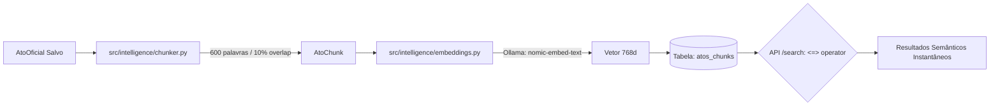

# Capítulo 03: Arquitetura RAG e Vetores
> "As palavras são apenas coordenadas em um mapa infinito de significados."

## 🎓 O que você vai aprender?
* O que é um Embedding (Vetor) e como ele captura significado conceitual.
* Como o operador de Cosseno (`<=>`) encontra matérias sem depender de palavras exatas.
* A importância da sobreposição (overlap) no particionamento (chunking).
* O fim do atraso de polling: como funciona a **vetorização imediata** no pipeline unificado.

---

## 1. Matemática Sem Dor: O que é um Embedding?

Imagine que cada palavra, frase ou parágrafo é uma estrela no céu. Estrelas que tratam de conceitos afins (ex: "Licitação para Pavimentação" e "Concorrência Pública de Asfalto") ficam posicionadas em constelações próximas no espaço vetorial.

Convertemos o texto limpo do Diário Oficial em uma lista de **768 números decimais** utilizando o modelo **`nomic-embed-text`**. Para o computador, comparar o sentido de dois textos resume-se a calcular o ângulo geométrico entre dois vetores.

---

## 🔍 Mergulho no Código: O Pipeline de Vetorização Imediata

### A. Fragmentação Inteligente (Chunking com Overlap)
No arquivo `src/intelligence/chunker.py`, implementamos a função `chunk_text`:
- **Tamanho da Janela:** Blocos de **600 palavras**.
- **Sobreposição (Overlap de 10%):** Cada bloco compartilha 60 palavras com o bloco anterior. Esse mecanismo evita que informações críticas (como números de contratos, nomes de partes ou datas) sejam cortadas abruptamente na fronteira entre dois blocos, preservando a coerência semântica.

### B. O Fim do Polling Lag: Vetorização no Ato
Em arquiteturas antiquadas, o sistema salvava o texto e deixava os chunks "órfãos" aguardando um loop secundário de polling acordar para gerar os vetores. Isso causava atrasos de minutos até que uma matéria pudesse ser encontrada na busca semântica.

No **`src/core/pipeline.py`**, a vetorização ocorre de forma imediata e linear:
```python
# Trecho do src/core/pipeline.py
if ato_processado.texto_limpo:
    chunks = chunk_text(ato_processado.texto_limpo)
    for c_text in chunks:
        vetor = await embeddings_client.get_embedding(c_text)
        await db_repo.insert_chunk(ato_id, c_text, embedding=vetor)
```
Assim que o ato recebe seu identificador via Single-Query UPSERT, seus fragmentos são fatiados, vetorizados e gravados no banco. **A matéria fica instantaneamente disponível para busca semântica.**

### C. A Rede de Segurança Defensiva (`drain_pending_vectors`)
O loop do `worker.py` mantém uma rotina chamada `drain_pending_vectors`. Ela **não** é o canal principal de vetorização, mas atua como um *sweeper* de resiliência: se o serviço do Ollama oscilar durante a ingestão de um lote pesado, quaisquer chunks que ficaram sem vetor são automaticamente recuperados e indexados no ciclo seguinte.

### D. A Busca em Milissegundos (`pgvector`)
No arquivo `src/persistence/pg_repository.py`, o método `search_similar_chunks` utiliza o operador `<=>` (Distância de Cosseno) da extensão **pgvector**:
```sql
SELECT c.id, c.texto_chunk, 1 - (c.embedding <=> $1::vector) AS similarity,
       a.identificador, a.titulo, a.secretaria, a.orgao, a.data_publicacao
FROM atos_chunks c
JOIN atos_oficiais a ON c.ato_id = a.id
WHERE c.embedding IS NOT NULL
ORDER BY c.embedding <=> $1::vector
LIMIT $2;
```
Calculada nativamente pelo motor em C do PostgreSQL, essa busca responde em poucos milissegundos mesmo sobre bases com milhares de fragmentos textuais.

---

## 3. Diagrama do Pipeline RAG



---

## 4. Para Aprofundar

- **Pesquise por:** "pgvector Cosine Distance vs L2 Distance no PostgreSQL".
- **Estude o conceito:** "Retrieval-Augmented Generation (RAG) chunking strategies".

---
[Voltar para o Índice](README.md) | [Próximo Capítulo: Infraestrutura e Operações](04-infraestrutura-e-operacoes.md)
