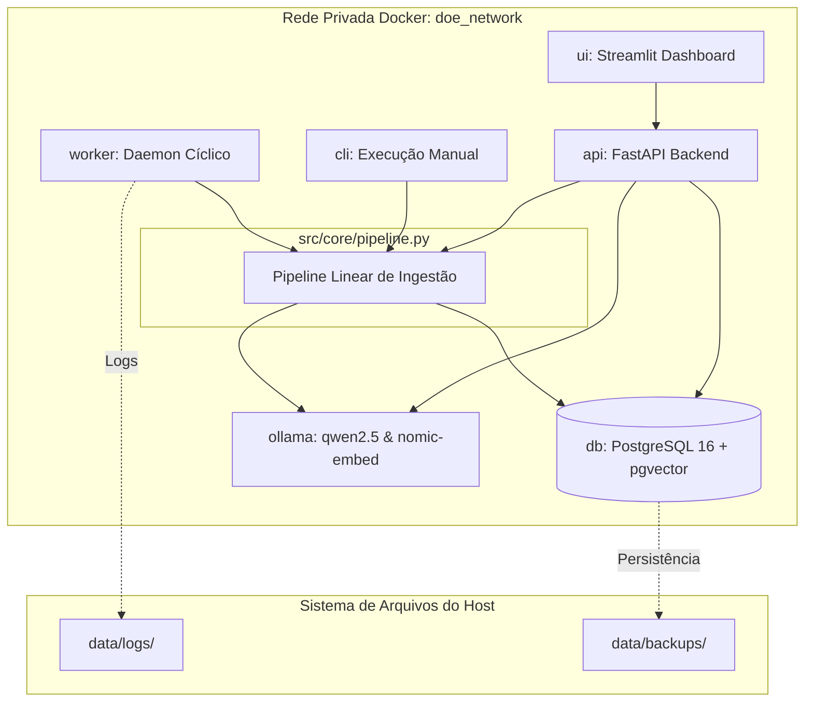

# Capítulo 04: Infraestrutura e Operações
> "Um castelo de inteligência só é forte se suas fundações forem sólidas e resilientes."

## 🎓 O que você vai aprender?
* Como os 5 serviços vitais operam em rede privada via Docker Compose.
* O fim de pastas temporárias em disco: a eficiência do buffer `io.BytesIO`.
* Como o Worker e o CLI atuam como clientes enxutos do pipeline unificado.
* Gestão segura de variáveis de ambiente com o `.env`.

---

## 🔍 Mergulho no Código: O Orquestrador e o Operário

Nesta camada, saímos da modelagem matemática e entramos na engenharia de sistemas robustos:

### A. O Ciclo do Worker (`src/worker.py`)
O Worker opera como um processo daemon enxuto e linear. Ao contrário de versões antigas que continham lógicas dispersas, o `worker.py` atua puramente como um despachante:
1. **Configuração Dinâmica:** Lê da tabela `system_settings` o intervalo de verificação (`polling_interval_minutes`) e se o monitoramento está ativo.
2. **Sweeper de Segurança:** Executa `drain_pending_vectors` para garantir que eventuais oscilações de rede passadas não deixem nenhum chunk sem vetor.
3. **Verificação da Edição do Dia:** Consulta o `DOEBahiaClient` em busca de publicações de hoje.
4. **Delegação ao Pipeline Canônico:** Repassa cada edição para **`process_edition_pipeline`** em `src/core/pipeline.py`, onde extração, inteligência, UPSERT e vetorização imediata são concluídos atomicamente.
5. **Dormência Controlada:** Aguarda o tempo de polling configurado antes de iniciar o próximo ciclo.

### B. O Painel de Linha de Comando (`src/cli.py`)
Para inspeções manuais, testes de carga ou backfills específicos, o `src/cli.py` permite invocar o mesmo pipeline unificado diretamente do terminal:
```bash
# Processar uma edição por ID
python -m src.cli 12345

# Processar por data específica
python -m src.cli 09/05/2026

# Processar um intervalo histórico
python -m src.cli "01/05/2026 até 05/05/2026"
```

### C. Eliminação de Buffers Temporários em Disco
Em arquiteturas antiquadas, grandes volumes de PDFs exigiam uma pasta `data/temp/` para arquivos temporários, gerando lentidão de I/O em disco e acúmulo de lixo quando um processo falhava.

No DOE-BA Intelligence Engine, o processamento de PDFs via **`io.BytesIO`** e a persistência exclusiva no PostgreSQL tornaram o disco rígido reservado para dados essenciais e permanentes:
- `data/logs/`: Diagnóstico técnico e auditoria operacional do sistema.
- `data/backups/`: Snapshots e dumps de segurança do banco de dados vetorial.

---

## 2. Orquestração Docker: Serviços Isolados

O arquivo `docker-compose.yml` define os 5 componentes do ecossistema:
1. **`db`:** PostgreSQL 16 + pgvector (porta interna 5432).
2. **`ollama`:** Runtime de inferência e embeddings (porta interna 11434).
3. **`api`:** Backend FastAPI para consultas semânticas e backfill (porta 8000).
4. **`worker`:** Daemon autônomo executando o pipeline cíclico.
5. **`ui`:** Operations Console em Streamlit (porta 8501).

---

## 3. Topologia da Rede Docker



---

## 4. Para Aprofundar

- **Pesquise por:** "Twelve-Factor App: Config and Concurrency".
- **Estude o conceito:** "Docker network bridge vs host mode".

---
[Voltar para o Índice](README.md)
