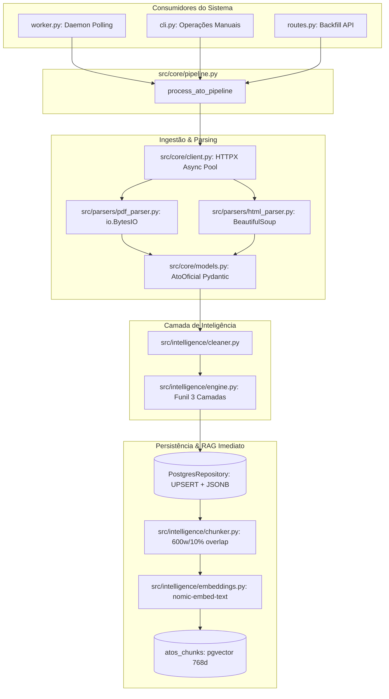

# 🗺️ Mapa do Repositório: DOE-BA Intelligence Engine
> "O conhecimento total da estrutura é o que separa um codificador de um Arquiteto de Sistemas."

Olá, aluno! Este é o seu **Atlas Técnico**. Abaixo, detalho não apenas onde os arquivos estão, mas **o que eles fazem internamente**, como se conectam e por que a arquitetura foi desenhada dessa forma.

---

## 📂 Pasta: `src/` (O Ecossistema de Código)

### 🧩 `src/core/` (Fundações, Pipeline e Contratos)
- **`pipeline.py`**:
    - **Funções Chave:** `process_ato_pipeline`, `process_edition_pipeline`.
    - **Papel:** O **coração do sistema**. Orquestra o fluxo linear e unificado de processamento: Extração $\to$ Limpeza $\to$ Funil de Inteligência $\to$ Persistência atômica com UPSERT $\to$ Chunking $\to$ Vetorização Imediata. Elimina qualquer atraso de polling na geração de embeddings.
- **`models.py`**:
    - **Esquemas Pydantic:** `AtoOficial` (modelo canônico de dados), `DownloadedDocument` (documento binário/MIME em memória), `AtoChunk`, `EntidadesExtraidas`, `DadosEstruturadosLLM`, `AtoSumarioRef`, `MetadadosEdicao`.
    - **Papel:** **Single Source of Truth** tipada e validada. Dita todos os contratos de dados do ecossistema, eliminando dicionários soltos ou tipagem fraca.
- **`client.py`**:
    - **Classe:** `DOEBahiaClient`.
    - **Funções Chave:** `get_editions_by_date`, `get_editions_by_range`, `get_summary_html`, `fetch_content`.
    - **Papel:** Cliente HTTP assíncrono de alta performance via `httpx.AsyncClient`. Utiliza **Connection Pooling** persistente, controle de concorrência com `asyncio.Semaphore(8)`, jitter randômico e retentativas com backoff exponencial para respeitar os limites do servidor legado Apache/2.2.22 da EGBA, sem depender de navegadores headless.
- **`config.py`**:
    - **Papel:** Centraliza variáveis de ambiente (`.env`), parâmetros operacionais do Ollama, modelos (`qwen2.5:1.5b`, `nomic-embed-text`) e DSN do PostgreSQL.

### 📄 `src/parsers/` (Extração Pura em Memória)
- **`pdf_parser.py`**:
    - **Função:** `extract_pdf_text`.
    - **Papel:** Extrai texto de PDFs binários **100% em memória RAM** utilizando `io.BytesIO` e `pdfplumber`. Garante ausência total de I/O em disco rígido e previne vazamentos de descritores de arquivo.
- **`html_parser.py`**:
    - **Funções:** `parse_metadata`, `parse_summary_tree`, `extract_html_text`.
    - **Papel:** Processamento sintático do HTML da EGBA com BeautifulSoup/lxml, isolando o texto limpo das matérias e mapeando a hierarquia administrativa de cada ato.

### 🧠 `src/intelligence/` (O Cérebro RAG)
- **`engine.py`**:
    - **Classe:** `IntelligenceEngine`.
    - **Lógica:** Implementa o **Funil de Inteligência Modular em 3 Camadas**:
        1. *Camada 1 (Lexical/Regex):* Filtro instantâneo contra a watchlist.
        2. *Camada 2 (NLP Estatístico):* Reconhecimento de Entidades Nomeadas (NER) via Spacy (`pt_core_news_sm`).
        3. *Camada 3 (Semântica/LLM):* Extração profunda estruturada e resumo via Ollama (`qwen2.5:1.5b`).
- **`cleaner.py`**:
    - **Função:** `clean_text`.
    - **Papel:** Sanitizador unificado que remove ruídos governamentais (brasões, rodapés legais, paginações, caracteres nulos e espaçamento excessivo).
- **`chunker.py`**:
    - **Função:** `chunk_text`.
    - **Matemática:** Fragmenta textos em janelas de **600 palavras** com **10% de overlap** (60 palavras) para preservar a continuidade de contexto semântico.
- **`embeddings.py`**:
    - **Classe:** `OllamaEmbeddings`.
    - **Papel:** Cliente assíncrono para o modelo `nomic-embed-text` (768 dimensões) do Ollama, operando com pool de conexões HTTP reutilizado e retentativas automáticas.

### 💾 `src/persistence/` (Memória Vetorial e Relacional)
- **`pg_repository.py`**:
    - **Classe:** `PostgresRepository`.
    - **Destaque:** Implementa Single-Query UPSERT (`ON CONFLICT (identificador) DO UPDATE ... RETURNING id`), colunas nativas **JSONB** (`entidades` e `dados_estruturados`) e busca vetorial por similaridade de cosseno via operador `<=>` do **pgvector**, consolidando toda a persistência relacional, analítica e semântica diretamente no banco.

### 🌐 `src/api/` (Acesso Externo e Backfill)
- **`main.py`**: Inicializa o FastAPI, documentação interativa OpenAPI/Swagger e middlewares.
- **`routes.py`**:
    - **Endpoints:** `/search` (busca semântica RAG), `/status` (inventário e métricas), `/settings` (configurações do worker), `/ingest/backfill` (ingestão histórica em background reutilizando o pipeline unificado) e `/watchlist/alerts`.
- **`dependencies.py`**: Injeção de dependências tipadas do repositório PostgreSQL e cliente de embeddings.

### 📊 `src/ui/` (A Janela do Usuário)
- **`app.py`**: Console Operacional em **Streamlit**. Permite busca semântica, monitoramento de inventário, alertas de watchlist e controle de polling em tempo real.

### 🛠️ `src/utils/` (Utilitários Compartilhados)
- **`helpers.py`**: Funções auxiliares para aplicação de jitter assíncrono, formatação de datas e parsing flexível de argumentos de consulta (IDs, datas únicas e intervalos).

### ⚙️ Consumidores do Pipeline (Raiz do `src/`)
- **`worker.py`**: O orquestrador cíclico (daemon). Realiza o polling de novas edições do dia, invoca o `process_edition_pipeline` e executa um sweeper de segurança defensivo para chunks pendentes.
- **`cli.py`**: Utilitário CLI para ingestão ad-hoc sob demanda por ID, data única ou intervalo de datas consumindo o mesmo pipeline unificado.

---

## 📁 Pasta: `docs/` (Centro de Inteligência Didático)
- **`TECHNICAL_MASTER.md`**: O manual técnico aprofundado para engenheiros e arquitetos.
- **`01-fundamentos-web-scraping.md` a `04-infraestrutura-e-operacoes.md`**: Curso didático sequencial do "Livro Mestre".
- **`MAPA_DO_REPOSITORIO.md`**: Este mapa da estrutura do repositório.
- **`README.md`**: Guia introdutório da documentação didática.

---

## 📄 Arquivos de Configuração e Raiz
- **`ARCHITECTURE.md`**: Manifesto de arquitetura, princípios RAG Local e diagramas de componentes.
- **`TECHNICAL_SPEC.md`**: Especificação técnica detalhada dos protocolos e dados.
- **`README.md`**: Portal de entrada do projeto com instruções de execução rápida.
- **`docker-compose.yml`**: Orquestração dos serviços conteinerizados (`db` com pgvector, `ollama`, `api`, `worker`, `ui`).
- **`watchlist.example.yaml`**: Exemplo de configuração de termos e pessoas para monitoramento contínuo.
- **`.env.example`**: Modelo de variáveis de ambiente.

---

## 🔗 Como os Módulos Conversam? (O Pipeline Unificado)

1. Qualquer consumidor (**`worker.py`**, **`cli.py`** ou a rota de **Backfill**) delega a execução diretamente ao **`src/core/pipeline.py`**.
2. O **`pipeline.py`** utiliza o **`DOEBahiaClient`** para baixar o conteúdo via HTTPX reutilizando conexões do pool.
3. Se for PDF, o **`pdf_parser.py`** extrai o texto diretamente na memória RAM via **`io.BytesIO`**; se for HTML, o **`html_parser.py`** extrai a estrutura textual.
4. O dado é validado pelo contrato canônico **`AtoOficial`** (`models.py`) e higienizado pelo **`cleaner.py`**.
5. O **`IntelligenceEngine`** executa o funil modular (Regex $\to$ Spacy NER $\to$ Ollama Fallback).
6. O **`PostgresRepository`** persiste o ato em uma única instrução SQL atômica (**Single-Query UPSERT**) gravando entidades e dados semânticos em colunas **JSONB nativas**.
7. Na mesma passada do pipeline, o texto é fatiado pelo **`chunker.py`** e **imediatamente vetorizado** via **`embeddings.py`**, gravando os vetores na tabela `atos_chunks`. Não há mais espera ou necessidade de polling para vetorização!

---
*Professor Sênior & Especialista em IA*
